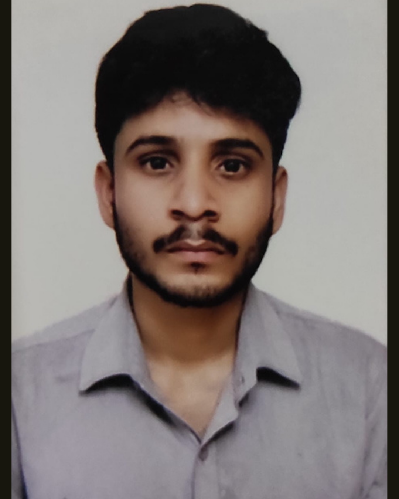

<!-- Portfolio-style GitHub profile README -->

  

  <a href="https://nksdev.github.io/nksdev/"><strong>OPEN INTERACTIVE PORTFOLIO ↗</strong></a>
  &nbsp; · &nbsp;
  <a href="https://github.com/nksdev?tab=repositories">ALL PROJECTS</a>
  &nbsp; · &nbsp;
  <a href="https://linkedin.com/in/namanmic">LINKEDIN</a>

  

---

<table>
<tr>
<td width="62%" valign="top">

## About

I’m a B.Tech student specializing in **Computer Science & Engineering — Cybersecurity and Digital Forensics**.

I’m interested in how modern systems authenticate users, exchange data, protect privacy, and fail. I learn by studying implementation details, testing assumptions in authorized environments, and documenting what the evidence actually shows.

**Current focus**
- Application security and authentication flows
- Systems architecture and network behavior
- Digital forensics and evidence integrity
- Privacy-first applications and AI systems
- Technical writing and architecture visualization

</td>
<td width="38%" valign="top">

### Working principles

- Understand before optimizing
- Test assumptions, don't trust them
- Make trade-offs explicit
- Prefer reproducible evidence

</td>
</tr>
</table>

## Selected projects

<table>
<tr>
<td width="50%" valign="top">

### The Brain AI

AI-assisted knowledge synthesis and multi-document interaction.

[View repository ↗](https://github.com/nksdev/THE-BRAIN-AI)

</td>
<td width="50%" valign="top">

### Privacy-First Cycle Tracker

A browser-based menstrual health tracker with local data persistence and an AI chat feature.

[View repository ↗](https://github.com/nksdev/privacy-first-cycle-tracker)

</td>
</tr>
<tr>
<td width="50%" valign="top">

### SecureShare

A security-oriented file-sharing project. Review the source and documentation to assess its design and safeguards.

[View repository ↗](https://github.com/nksdev/secureshare)

</td>
<td width="50%" valign="top">

### Systems Blog Platform

A web platform project aligned with my interest in explaining how software systems work.

[View repository ↗](https://github.com/nksdev/systems-blog-platform)

</td>
</tr>
</table>

## Technical areas

  
  
  
  
  

  

| Area | What I explore |
|---|---|
| Application security | Authentication, sessions, authorization, web security testing |
| Systems and networking | Protocols, request flows, data movement, trust boundaries |
| Digital forensics | Evidence integrity, artifacts, repeatable investigation |
| Privacy-first engineering | Data minimization, local storage, security trade-offs |
| AI systems | Knowledge workflows, model integrations, application security |

## Connect

  
  
  

---

  <em>Understanding systems is more important than simply using them.</em> 
  <strong><a href="https://nksdev.github.io/nksdev/">VIEW THE INTERACTIVE PORTFOLIO ↗</a></strong>

